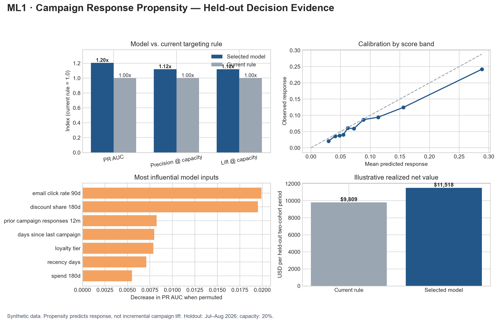

<p align="center">
  
</p>

# Machine Learning Decision Systems

[](https://github.com/laura-rivera-sancho/machine-learning-standard-framework/actions/workflows/ci.yml)

**Reproducible machine-learning case studies for prioritization, segmentation, and responsible model operation.**

[Read the campaign recommendation](supervised_learning/campaign_response_propensity/reports/stakeholder_readout.md) · [Open the executive visual](supervised_learning/campaign_response_propensity/reports/ml1_executive_summary.png) · [Review the model card](supervised_learning/campaign_response_propensity/model_card/model_card.md) · [Contact Laura](mailto:laura.riverasancho33@gmail.com)

This repository shows how I move from an operational decision to a defensible model: defining the target and eligible population, preventing leakage, validating through time, comparing realistic baselines, evaluating decisions at actual capacity, documenting risks, and establishing monitoring before release.

[](supervised_learning/campaign_response_propensity/reports/stakeholder_readout.md)

*Synthetic demonstration evidence—[read the campaign decision memo](supervised_learning/campaign_response_propensity/reports/stakeholder_readout.md) or [inspect the reproducible findings](supervised_learning/campaign_response_propensity/case_study/expected_results.md).*

## The decision this supports

Can a team improve a capacity-constrained prioritization or segmentation decision without introducing leakage, unstable behavior, unreviewed customer impact, or an operating model it cannot support?

The cases cover campaign-response prioritization, inactivity-risk prioritization, customer segmentation, and the controls required to release, monitor, retrain, or roll back a model responsibly.

## ML prioritization pilot at a glance

| Item | Typical scope |
|---|---|
| **Best for** | CRM, retention, growth, product, or operations teams with a defined decision, historical outcomes, and a constrained intervention capacity |
| **Duration** | About 4 weeks for one bounded prediction or segmentation decision |
| **Inputs** | Decision and current baseline; eligible population; point-in-time features; outcome or similarity definition; capacity and economics; consent and exclusion rules; decision and data owners |
| **Week 1** | Confirm the decision contract, population, target or similarity definition, feature timing, baseline, risks, and acceptance criteria |
| **Weeks 2–3** | Validate data, compare candidates, test temporal or stability behavior, evaluate important segments, and document limitations |
| **Week 4** | Deliver the reproducible workflow, validation report, model card, executive recommendation, monitoring plan, and shadow-pilot or activation design |
| **Buyer receives** | Baseline comparison, reusable scoring or segmentation workflow, decision-ready validation, model card, monitoring and rollback plan, and executive readout |
| **Not included** | Automated customer action, causal-impact claims, production-system integration, protected-class targeting, or broad rollout without an approved operational test |

Exact timing depends on data readiness, label maturity, decision-system access, review requirements, and the complexity of the operational handoff.

## Pilot acceptance criteria

Thresholds should be agreed after the data-readiness review. At minimum:

- populations, labels, feature cutoffs, exclusions, and historical splits reconcile to the written decision contract;
- no future, outcome-derived, or operationally unavailable information enters model development or scoring;
- candidates are compared with the actual current process at the real capacity or activation constraint;
- calibration, ranking or stability, important segments, and failure cases are reported together;
- consent, suppression, human approval, monitoring, and rollback responsibilities remain visible; and
- the final readout names the go, iterate, or stop decision and the evidence required next.

## Demonstration evidence

All figures below come from deterministic fictional or synthetic data. They demonstrate evaluation mechanics and decision design—not observed customer behavior, causal intervention impact, or guaranteed business value.

| Case study | Synthetic reference result | Recommended next decision |
|---|---|---|
| [Campaign Response Prioritization](supervised_learning/campaign_response_propensity/README.md) | At 20% capacity, the selected model identifies 439 responders versus 392 for the current rule—47 additional responders on the held-out reference cohort | Advance to shadow scoring and a randomized operational pilot |
| [Inactivity Risk Prioritization](supervised_learning/paywave_inactivity/README.md) | At 5,000-customer capacity, the selected model identifies 3,853 future-inactive customers—552 more than the recency rule | Validate score stability and intervention value before activation |
| [Customer Segmentation](unsupervised_learning/customer_segmentation/README.md) | Four-cluster K-means assigns 100% of the reference population; the smallest segment represents 18.1% and bootstrap stability ARI is 0.846 | Use segments as testable planning hypotheses, not fixed identities |
| [Model Release & Operating Readiness](production_readiness/README.md) | Versioned release evidence, approval boundaries, monitoring, retraining, rollback, incident response, and an executable manifest validator | Require an approved, reversible release path before production use |

## What the buyer can inspect

| Evidence | Start here | What it shows |
|---|---|---|
| Executive recommendation | [Campaign-response stakeholder readout](supervised_learning/campaign_response_propensity/reports/stakeholder_readout.md) | Baseline comparison, limitations, operating implications, and next decision |
| Visual evidence | [Campaign-response executive visual](supervised_learning/campaign_response_propensity/reports/ml1_executive_summary.png) | Held-out ranking, calibration, important inputs, and illustrative economics |
| Second supervised case | [PayWave inactivity readout](supervised_learning/paywave_inactivity/reports/stakeholder_readout.md) | Transfer of the workflow to another decision, population, and capacity constraint |
| Unsupervised decision | [Customer segmentation readout](unsupervised_learning/customer_segmentation/reports/stakeholder_readout.md) | Candidate comparison, stability, coverage, profiles, and activation boundaries |
| Responsible use | [Campaign-response model card](supervised_learning/campaign_response_propensity/model_card/model_card.md) | Intended use, exclusions, risks, human ownership, and monitoring expectations |
| Operating controls | [Model Release & Operating Readiness](production_readiness/README.md) | Release contracts, registry lineage, monitoring, retraining, rollback, and incident response |
| Reproducible implementation | [Campaign-response source](supervised_learning/campaign_response_propensity/src), [segmentation source](unsupervised_learning/customer_segmentation/src), and [automated tests](tests) | Deterministic data, reusable workflows, analytical controls, and repository quality checks |

## Demonstration boundary

The companies, customer records, business assumptions, and results are fictional or synthetically generated. The repository demonstrates model-development judgment, validation, communication, and operational controls. It does not show that a real organization achieved these results or that model-led outreach or treatment causes a better outcome.

## How an engagement would start

1. Identify one bounded decision, the current process, the action capacity, and the decision owner.
2. Review the available historical data, label timing, exclusions, consent rules, and operational constraints.
3. Confirm the written scope, baseline, evaluation plan, deliverables, acceptance criteria, and stop conditions.
4. Begin only after data access, ownership, review responsibilities, and the shadow or activation path are agreed.

For an initial scope discussion, [email Laura](mailto:laura.riverasancho33@gmail.com) with the decision you need to make, the available historical data, the current baseline, and the target timeline.

## Technical reference

### Repository map

```text
machine-learning-standard-framework/
├── supervised_learning/
│   ├── campaign_response_propensity/  # Campaign prioritization and pilot design
│   └── paywave_inactivity/             # Inactivity-risk prioritization
├── unsupervised_learning/
│   └── customer_segmentation/          # Stable, interpretable customer groups
├── production_readiness/               # Release, monitoring, rollback, and incident controls
├── tests/                              # Model logic and repository integrity
├── ROADMAP.md
└── README.md
```

### Reproduce the case studies

Use Python 3.11 or 3.12:

```bash
python -m venv .venv
source .venv/bin/activate  # Windows PowerShell: .venv\Scripts\Activate.ps1
pip install -r requirements-dev.txt

python supervised_learning/campaign_response_propensity/src/generate_synthetic_data.py
python supervised_learning/campaign_response_propensity/src/train_evaluate.py
python supervised_learning/campaign_response_propensity/src/create_visuals.py

python supervised_learning/paywave_inactivity/src/generate_synthetic_data.py
python supervised_learning/paywave_inactivity/src/train_evaluate_models.py

python unsupervised_learning/customer_segmentation/src/generate_synthetic_data.py
python unsupervised_learning/customer_segmentation/src/segment_evaluate.py
python unsupervised_learning/customer_segmentation/src/create_visuals.py
python production_readiness/src/validate_release_manifest.py production_readiness/contracts/example_release_manifest.json
pytest
```

### Design principles

- Start with the operational decision, capacity, and error costs.
- Define the target, horizon, eligibility, and observation cutoff before feature engineering.
- Compare models with a realistic current-state baseline.
- Match validation to how the model will encounter future data.
- Evaluate ranking, calibration, economics, and segment behavior—not accuracy alone.
- For unsupervised models, evaluate stability, coverage, minimum size, interpretability, and actionability—not separation alone.
- Treat model explanations as predictive evidence, not causal conclusions.
- Separate propensity modeling from uplift or treatment-effect estimation.
- Require monitoring, rollback, and human ownership before production use.

## License and citation

This project is available under the [MIT License](LICENSE). Citation metadata are provided in [CITATION.cff](CITATION.cff).
