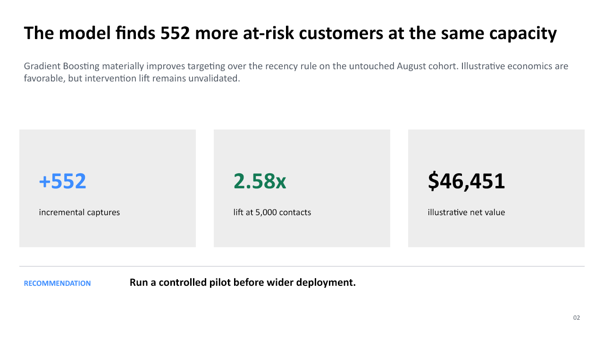

# PayWave — Inactivity Risk Prioritization

**A capacity-aware workflow for identifying customers whose future inactivity risk warrants review.**

[Read the stakeholder recommendation](reports/stakeholder_readout.md) · [Open the executive visual](reports/executive_summary.png) · [Review the model card](model_card/model_card.md) · [Contact Laura](mailto:laura.riverasancho33@gmail.com)

## The decision this supports

Which active PayWave customers should receive retention outreach when the team can contact only 5,000 customers per scoring cycle?

The selected Gradient Boosting model predicts inactivity within 30 days. It supports a ranked, capacity-constrained shortlist; it does not establish that outreach prevents inactivity.

## Pilot at a glance

| Item | Typical scope |
|---|---|
| **Duration** | About 4 weeks for one bounded prioritization decision |
| **Inputs** | Point-in-time activity history, inactivity definition, eligibility and consent rules, outreach capacity, current baseline, intervention assumptions, and decision owners |
| **Buyer receives** | Baseline comparison, reproducible scoring workflow, prioritized eligible population, validation report, model card, monitoring plan, and shadow-pilot design |
| **Not included** | Automated outreach, causal retention claims, production CRM integration, or broad rollout without an operational test |

## Synthetic demonstration evidence

On the deterministic 29,999-customer synthetic held-out test cohort, the model identifies **3,853 future-inactive customers** within the 5,000-customer capacity—**552 more** than the recency rule. Precision is **77.06%**, recall is **42.99%**, and lift is **2.58x**. These figures demonstrate the evaluation workflow; they are not observed customer outcomes or evidence that outreach prevents inactivity.

[Download the five-slide executive PowerPoint](reports/stakeholder_readout.pptx) or review the [stakeholder memo](reports/stakeholder_readout.md).



## Review path

| Resource | Purpose |
|---|---|
| [Executive PowerPoint](reports/stakeholder_readout.pptx) | Non-technical recommendation, evidence, limitations, and pilot plan |
| [Stakeholder readout](reports/stakeholder_readout.md) | Decision memo and detailed findings |
| [Method notes](method_notes.md) | Predictive-modeling concepts and interpretation |
| [Delivery methodology](methodology.md) | End-to-end supervised workflow |
| [Business case](case_study/business_case.md) | Decision, population, horizon, capacity, and success criteria |
| [Data dictionary](case_study/data_dictionary.md) | Feature definitions and leakage controls |
| [Reference findings](case_study/expected_results.md) | Deterministic reference evidence |
| [Model card](model_card/model_card.md) | Intended use, limitations, controls, and approval boundary |
| [Monitoring plan](case_study/monitoring_plan.md) | Data, drift, performance, and rollback thresholds |
| [Source](src) | Synthetic generator and model-comparison workflow |

## Reproduce

From the repository root:

```bash
python supervised_learning/paywave_inactivity/src/generate_synthetic_data.py
python supervised_learning/paywave_inactivity/src/train_evaluate_models.py
pytest
```

The full generated data and processed outputs are ignored. A deterministic review sample is versioned.

## Start a scope discussion

[Email Laura](mailto:laura.riverasancho33@gmail.com) with the decision you need to make, the available activity history, the current prioritization process, the outreach capacity, and the target timeline.
