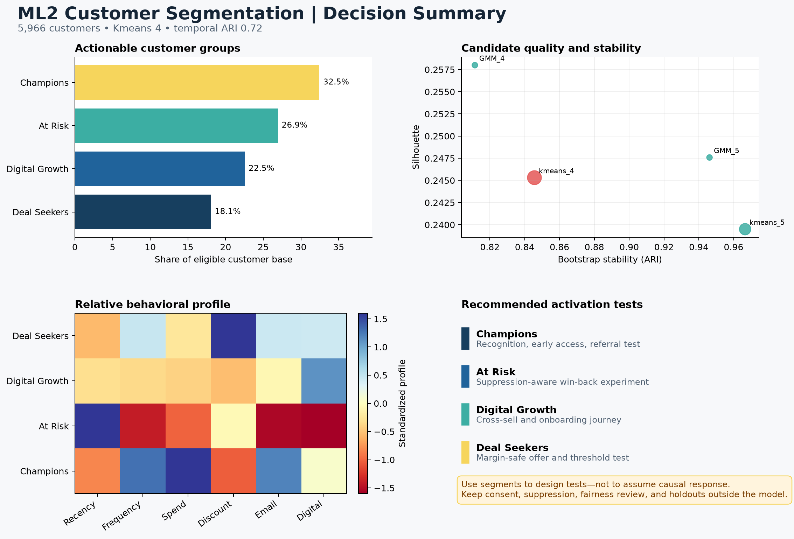

# Customer Segmentation for Activation

**A stability-tested workflow for turning customer behavior into reviewable, testable planning groups.**

[Read the stakeholder recommendation](reports/stakeholder_readout.md) · [Open the executive visual](reports/ml2_executive_summary.png) · [Review the model card](model_card/model_card.md) · [Contact Laura](mailto:laura.riverasancho33@gmail.com)

**Decision:** Which durable, behaviorally distinct customer groups should guide differentiated marketing tests beyond fixed RFM rules?

Northstar Market currently uses broad lifecycle rules. This case compares K-means, Gaussian Mixture Models (GMM), and DBSCAN on two synthetic customer snapshots. Selection balances separation with stability, coverage, minimum segment size, interpretability, and operational usefulness.

## Pilot at a glance

| Item | Typical scope |
|---|---|
| **Duration** | About 4 weeks for one bounded customer decision |
| **Inputs** | Declared as-of snapshots, behavior and value features, eligibility rules, current segmentation approach, activation options, and business reviewers |
| **Buyer receives** | Candidate comparison, reproducible segmentation workflow, stability and coverage assessment, interpretable profiles, model card, monitoring plan, and activation-test design |
| **Not included** | Automated customer treatment, permanent identity labels, causal lift claims, or production activation without a controlled test |

## Synthetic demonstration evidence

On deterministic synthetic customer snapshots, K-means with four clusters is the reference solution. It segments **5,966 customers** with:

- **0.245 silhouette**, indicating useful but intentionally non-perfect behavioral separation
- **0.846 bootstrap stability ARI**
- **0.717 temporal assignment ARI** across two snapshots
- **100% coverage** and an **18.1% smallest-segment share**

The four interpretable groups are Champions, At Risk, Digital Growth, and Deal Seekers. These figures demonstrate candidate evaluation and stability testing, not observed customer behavior. The recommendation is to use the groups as testable planning hypotheses—not permanent customer identities or proof that an intervention will work.



## Review path

1. [Stakeholder readout](reports/stakeholder_readout.md)
2. [Five-slide executive PowerPoint](reports/stakeholder_readout.pptx)
3. [Business case](case_study/business_case.md)
4. [Reference findings](case_study/expected_results.md)
5. [Method notes](method_notes.md)
6. [Delivery methodology](methodology.md)
7. [Model card](model_card/model_card.md)
8. [Monitoring plan](case_study/monitoring_plan.md)
9. [Source implementation](src)

## Reproduce

From the repository root:

```bash
python unsupervised_learning/customer_segmentation/src/generate_synthetic_data.py
python unsupervised_learning/customer_segmentation/src/segment_evaluate.py
python unsupervised_learning/customer_segmentation/src/create_visuals.py
pytest
```

The full generated dataset and processed assignments are intentionally ignored. A deterministic [review sample](data/raw/customer_snapshots_sample.csv) and [reference results](reports/reference_results.json) are versioned.

## Start a scope discussion

[Email Laura](mailto:laura.riverasancho33@gmail.com) with the customer decision you need to support, the available behavioral history, the current segmentation approach, the activation options, and the target timeline.
